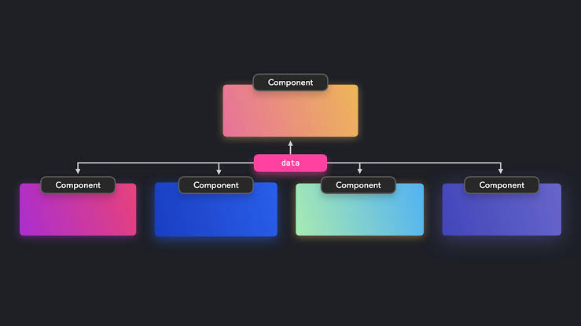

In the React ecosystem, a **design pattern** is a proven, repeatable solution to a common problem in building user interfaces. Because React is largely unopinionated, developers have organically established these patterns over the years to handle logic reuse, state sharing, and component composition.

If architecture is the blueprint of the house, design patterns are the specific techniques used to wire the electricity or frame the doors.

Here are the four most important modern design patterns you need to know in React.

---

### 1. The Custom Hook Pattern (Logic Reuse)

Before 2019, if two components needed to share the same logic (like tracking window size or fetching data), developers used clunky patterns like Higher-Order Components (HOCs) or Render Props.

Today, the standard pattern for reusing logic is the **Custom Hook**.

- **The Problem:** You have complex state or lifecycle logic that multiple components need, but you don't want to duplicate the code.
- **The Pattern:** You extract the React hooks (`useState`, `useEffect`) into a standalone JavaScript function prefixed with `use`.
- **Why it's powerful:** It perfectly separates _what_ the component is rendering from _how_ it gets its data.

```jsx
// The Pattern: Encapsulating logic
function useWindowSize() {
  const [size, setSize] = useState({ width: 0, height: 0 });

  useEffect(() => {
    const handleResize = () =>
      setSize({ width: window.innerWidth, height: window.innerHeight });
    window.addEventListener("resize", handleResize);
    return () => window.removeEventListener("resize", handleResize);
  }, []);

  return size;
}

// The Usage
const Navbar = () => {
  const { width } = useWindowSize(); // Clean, reusable, and easy to read
  return width > 768 ? <DesktopMenu /> : <MobileMenu />;
};
```

### 2. The Compound Component Pattern (UI Building)

When you build complex UI elements—like a dropdown menu, a set of tabs, or an accordion—you often have a parent component that needs to manage state for multiple child components.

- **The Problem:** Passing state down via props leads to massive, rigid "God Components" (e.g., `<Tabs activeColor="blue" onTabChange="{fn}" tabsData="{data}"/>`).
- **The Pattern:** You create a family of components that secretly share state behind the scenes using React Context, allowing the developer using them to arrange the layout however they want.

Notice how clean the usage is. The parent `<Menu>` manages the open/closed state, but the user decides exactly where the Trigger and the Items go:


```jsx
<Menu>
  <Menu.Trigger>Actions</Menu.Trigger>
  <Menu.List>
    <Menu.Item onSelect={handleEdit}>Edit</Menu.Item>
    <Menu.Item onSelect={handleDelete}>Delete</Menu.Item>
  </Menu.List>
</Menu>
```

### 3. The Provider Pattern (Dependency Injection)

This is the pattern underlying almost every major React library, from Redux to styled-components to React Router.

- **The Problem:** You have global data (like a user theme, authentication state, or a routing engine) that needs to be accessed by components deep down in the tree. Passing it as props layer by layer (Prop Drilling) is a nightmare.
- **The Pattern:** You wrap a section of your app in a `Provider` component. Any component inside that wrapper, no matter how deep, can "hook" into the provider to get the data.
  

```jsx
// 1. Wrap the app
<ThemeProvider value="dark">
  <App />
</ThemeProvider>;

// 2. Access it anywhere deep in the tree
const Button = () => {
  const theme = useContext(ThemeContext);
  return <button className={`btn-${theme}`}>Click Me</button>;
};
```

### 4. Controlled vs. Uncontrolled Components (State Inversion)

This pattern dictates how you handle forms and inputs, but it applies to almost any component with internal state.

- **Uncontrolled Pattern:** The component manages its own state internally using a `ref`. The parent component only asks for the value when it needs it (e.g., on form submit). This is faster but less flexible.
- **Controlled Pattern:** The component gives up its state. The parent passes in a `value` and an `onChange` handler.

**Why Controlled matters:** By forcing the component to be "controlled" by the parent, you can intercept the state. For example, if you want to force all text in an input to be uppercase, the parent can intercept the `onChange` event, uppercase the string, and pass it back down as the `value`.

---

### A Note on Legacy Patterns

If you look at older React codebases (pre-2019), you will see two patterns everywhere:

1. **Higher-Order Components (HOCs):** Functions that take a component and return a new component with injected props (e.g., `withRouter(MyComponent)`).
2. **Render Props:** Passing a function as a prop to share logic (e.g., `<MouseTracker render="{mouse"> <p>X: {mouse.x}</p>} />`).

While these still technically work, **Custom Hooks** have almost entirely replaced them because hooks don't create "wrapper hell" (deeply nested component trees just to share logic).
