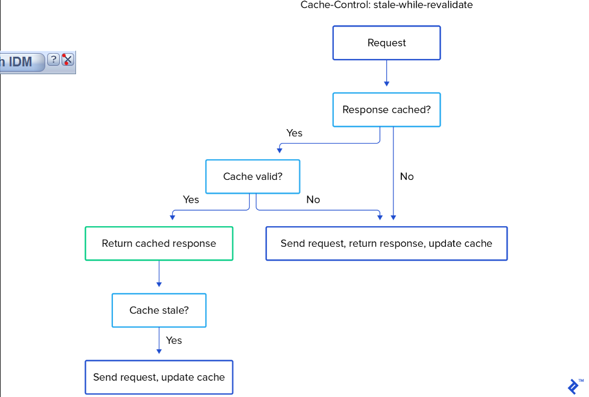

To understand how tools like React Query (now TanStack Query) fit into modern React architecture, you have to look at the problem they solve: **the client-server disconnect.**



Before these tools, developers treated data fetching as a one-time event. You fetched data on mount, shoved it into a global Redux store, and treated that store as the source of truth. But that data was actually just a snapshot of the server at a specific moment in time. It was instantly outdated.

React Query introduces a dedicated **Data Layer** that sits between your UI and your backend, acting as an intelligent, auto-updating cache.

---

### 1. The Core Philosophy: Stale-While-Revalidate

The architectural backbone of React Query is the **stale-while-revalidate** caching strategy.

Instead of forcing the user to look at a loading spinner every time they switch pages, React Query does the following:

1. **Check Cache:** When a component requests data, React Query instantly provides whatever is in the cache (even if it's considered "stale" or old).
2. **Background Fetch:** While the user is looking at the stale data, React Query silently fetches the freshest data from the server in the background.
3. **Swap:** Once the fresh data arrives, it swaps out the stale data. React only re-renders the specific parts of the UI that changed.

This makes your application feel unbelievably fast, because the perceived load time for cached data is **zero milliseconds**.

### 2. Query Keys: The Architectural Structure

In a React Query architecture, your entire backend is mapped to the client using **Query Keys**. These are unique arrays that describe the data being fetched.

Think of Query Keys as the dependency array for your server state.

- `['users']` (Fetches the whole list of users)
- `['users', { status: 'active' }]` (Fetches only active users)
- `['user', 14]` (Fetches a specific user by ID)

When you structure your keys logically, invalidating data becomes incredibly precise. If you add a new user, you don't have to manually update a complex global state object. You simply tell React Query: _"Invalidate any query that starts with `['users']`."_ React Query handles the refetching automatically across your entire app.

### 3. Decoupling UI from Fetching

Architecturally, you should **never** write a raw `useQuery` hook inside a UI component. It violates the separation of concerns.

Instead, you create a custom hook layer that encapsulates the API call, the Query Key, and the caching logic:

```jsx
// hooks/useUsers.js
export const useUsers = (status) => {
  return useQuery({
    queryKey: ["users", { status }],
    queryFn: () => fetchUsersFromServer(status),
    staleTime: 1000 * 60 * 5, // Data is fresh for 5 minutes
  });
};
```

Your UI component then consumes it cleanly:

```jsx
// components/UserList.jsx
const UserList = () => {
  const { data: users, isLoading, isError } = useUsers("active");

  if (isLoading) return <Spinner />;
  if (isError) return <ErrorMessage />;

  return (
    <ul>
      {users.map((user) => (
        <li key={user.id}>{user.name}</li>
      ))}
    </ul>
  );
};
```

### 4. Mutations and Optimistic Updates

Fetching data is only half the battle; modifying it (creating, updating, deleting) is where architectures usually break down. React Query handles this with **Mutations**.

A mature architecture implements **Optimistic Updates** for mutations.

1. The user clicks "Like" on a post.
2. Before the server even responds, React Query manually updates the cache so the heart icon instantly turns red (optimistic).
3. The mutation fires to the backend.
4. If the backend fails, React Query automatically rolls the cache back to the previous state and shows an error.

By moving all of this complexity into the Data Layer, your UI components become incredibly simple and resilient.
