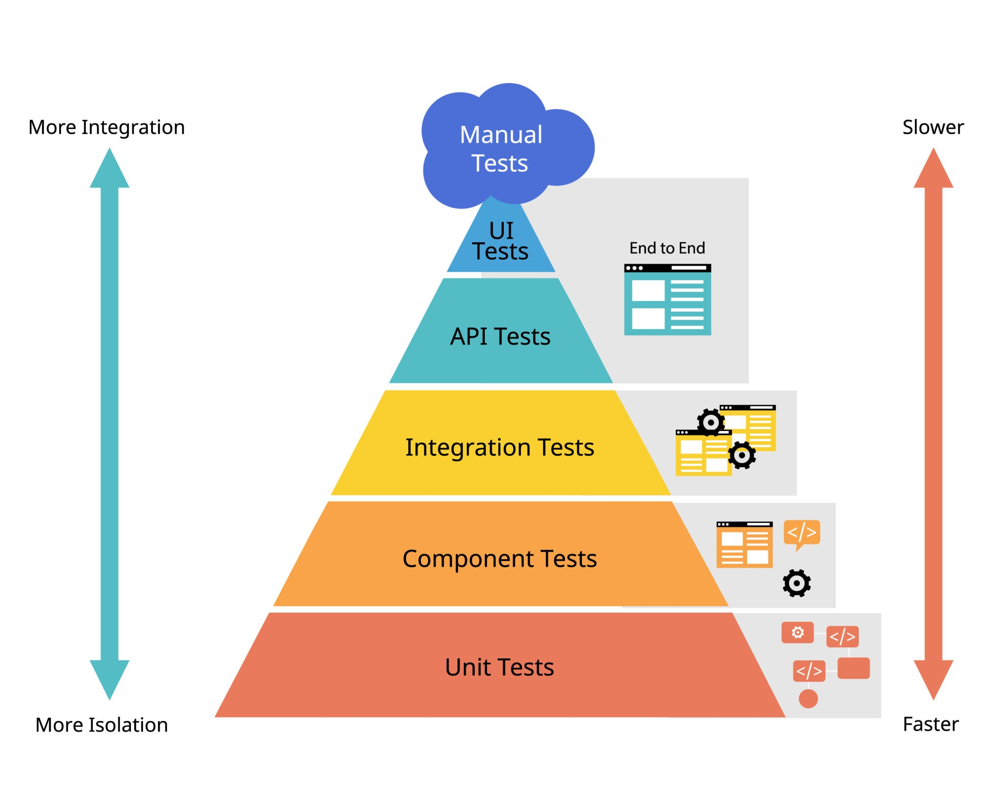

Testing in the React ecosystem is the automated process of verifying that your components, functions, and user interfaces behave as expected before they reach the user. Because React is heavily component-driven, testing focuses on rendering components in isolated environments, simulating user interactions, and asserting that the resulting DOM matches your expectations.

Here is a full breakdown of the concepts, types, and tools you need to know.

---

## 1. The Types of Tests

React testing typically follows the "testing pyramid," which balances the speed of execution against the confidence that the app works in reality.

| Test Type               | What it Does                                                                           | Focus                                                                            | Speed & Cost                                          |
| ----------------------- | -------------------------------------------------------------------------------------- | -------------------------------------------------------------------------------- | ----------------------------------------------------- |
| **Unit Testing**        | Tests a single function, hook, or small component in total isolation.                  | Does this button render? Does this math function return the right value?         | Very fast, inexpensive.                               |
| **Integration Testing** | Tests how multiple components or units work together.                                  | Does a form component correctly validate input and pass it to a submit function? | Moderate speed, high confidence.                      |
| **End-to-End (E2E)**    | Runs the entire application in a real browser, exactly as a user would experience it.  | Can a user log in, add an item to the cart, and check out successfully?          | Slow, can be flaky, but gives the highest confidence. |
| **Snapshot Testing**    | Renders a component to a string of HTML and compares it to a saved "baseline" version. | Did the UI accidentally change during a recent refactor?                         | Fast, but prone to "snapshot fatigue" if overused.    |

---

## 2. The Standard Toolchain

While you can mix and match, a modern React testing stack usually consists of a **Test Runner**, a **Component Testing Library**, and an **E2E Framework**.

### The Test Runners (The Engine)

These execute your test files, provide the assertion functions (like `expect(x).toBe(y)`), and create a fake DOM environment (like `jsdom`) so React can render without a real browser.

- **Jest:** The traditional standard, originally built by Facebook. It comes pre-configured with Create React App and handles mocking, running tests, and assertions.
- **Vitest:** A modern, incredibly fast test runner built for Vite. It is largely compatible with Jest's API but runs much faster natively.

### The Component Testers (The Interactors)

These tools actually mount your React components into the test runner's fake DOM and let you query elements and fire events.

- **React Testing Library (RTL):** The undisputed industry standard. Its core philosophy is: _"The more your tests resemble the way your software is used, the more confidence they can give you."_ Instead of testing the internal state of a component, RTL forces you to find elements by their visible text or accessibility roles (just like a user would) and interact with them.
- **Enzyme:** An older library by Airbnb. It allowed testing the internal state and methods of React class components. It is largely considered deprecated for modern React (especially with Hooks).

### The E2E Frameworks (The Browsers)

These spin up actual instances of Chrome, Firefox, or Safari to test your live app.

- **Cypress:** A highly visual, developer-friendly tool that runs directly in the browser and offers time-travel debugging.
- **Playwright:** Microsoft's modern alternative. It is incredibly fast, supports multiple tabs/iframes, and runs across all modern browser engines natively.

---

## 3. Core Concepts in Practice

To write effective tests in React, you will frequently rely on two techniques:

- **Mocking:** Replacing external dependencies (like an API call, a database, or a complex third-party library) with a fake, controlled version. For example, instead of actually fetching user data from a server during a unit test, you "mock" the `fetch` function to instantly return a dummy JSON object. This keeps tests fast and deterministic.
- **AAA Pattern (Arrange, Act, Assert):** The standard structure for writing a test case.

1. **Arrange:** Render the component and set up any required mocks.
2. **Act:** Simulate a user action (e.g., clicking a button or typing in an input).
3. **Assert:** Check that the expected outcome occurred (e.g., a success message appeared on the screen).
